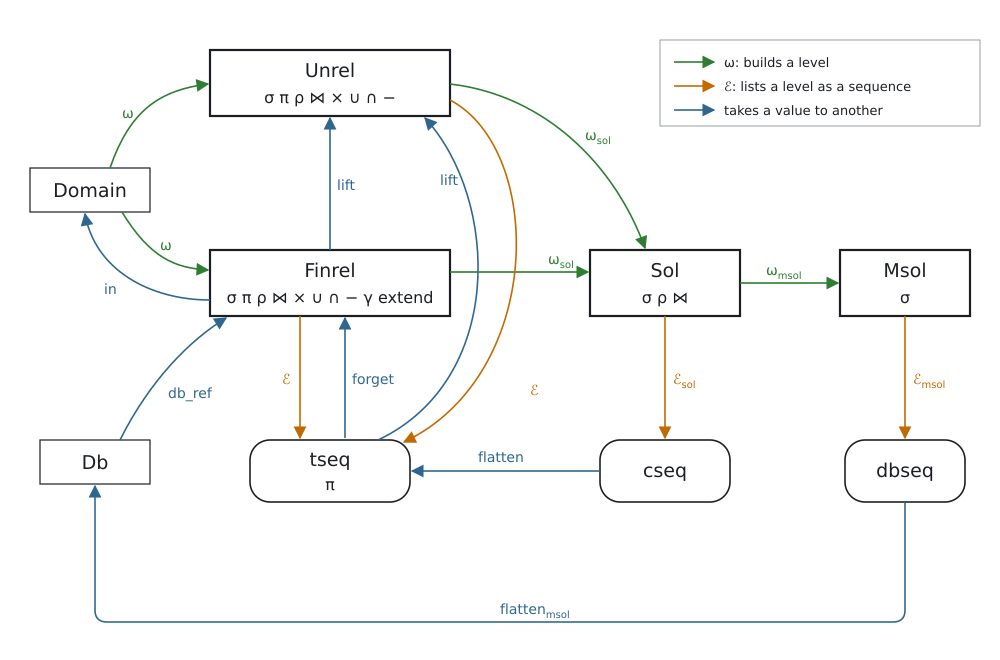

# 1 Introduction

## 1.1 Purpose

This technical report is part of the first author’s doctoral research at the University of Technology Sydney on query languages for subset selection and optimisation. Data management and combinatorial search meet in many applications: a database holds what *is*, and a search problem asks what *could be*, and which of those possibilities is best. The research asks whether one relational algebra, an extension of Codd’s [[20](references.md#codd_1970_relational.model.data.large.shared), [19](references.md#codd_1972_relational.completeness.data.base.sublanguages)], can state both. The question has been asked for more than three decades: among the answers, Cadoli and Mancini’s NP-Alg, the equation algebra of Biskup et al. and Koch’s world-set algebra each extend relational algebra to state search problems, and capture the NP properties or more (Chapter [9](sol.md)). The Rasso paper [[58](references.md#pratten_2025_relational.algebras.subset.selection.optimisation)] gave an answer, with three algebras: on finite relations, on relations given by a characteristic function, and on sets of relations built by exponentiation.

Rasso makes the space of candidate solutions, the function space $`\mathit{Decision}^{\mathit{Data}}`$, an operand, and lifts Codd’s operators to act on it: selection keeps candidates, and join combines two search spaces into one. Because the lifted algebra’s carrier is a function space and not a power set, the lifted operators stay within it, so search problems compose as queries do, one level up, and an order on the candidates states an objective. The same operators state data transformation and search, and they come with what a system needs: the kinds of laws that an optimiser could use to rewrite a search problem (Appendix [B](laws.md)), and a translation, $`\Phi`$, for problems too large to list or over infinite domains (Chapter [13](phi.md)).

This technical report clarifies the Rasso paper’s terminology, states the algebras precisely, and proves key properties of them in Lean. The authors wrote the definitions and the statements of the properties and plan to release new versions as research progresses. Claude (Anthropic) helped write the report, the Lean proofs and their sketches (Appendix [A](proofs.md)). Lean checks each proof. Whether the definitions and statements say what we intend is being investigated, and we welcome readers’ checks.

## 1.2 The algebras, the paper, Abstract Syntax Tree(AST), surface languages, and implementations

*Rasso* is the name of the algebras and the *Rasso paper* is the paper that introduced it [[58](references.md#pratten_2025_relational.algebras.subset.selection.optimisation)]. Rasso has one AST, multiple surface languages and multiple implementations.

**The AST**

*rassoAST* is the abstract syntax tree of Rasso, in JSON. It is the common representation that the surface languages are translated to and from, and which the implementations evaluate. RassoAST conforms to a JSON schema.

**The surface languages.**

The surface languages are designed to make the algebra readable to multiple audiences. The examples in the Rasso paper and in this report use the *$`\rho \alpha`$&#8203;* surface language with the traditional mathematical notation for relational algebra. This report also uses *RassoLean terms*, which write a program as a Lean value of type `Rasso.Program`. Translation from one surface language to another is always via *rassoAST*. Other surface languages exist but they are not used in this report: *.rasso* text which replaces the mathematical notation with ASCII characters, *rassoSQL* in the style of SQL, and *rassoInRules* which is in the style of Datalog and ASP.

**The implementations**

The implementations are designed to validate the algebra and its interpretation. The Lean 4 [[54](references.md#moura_2021_lean.theorem.prover.programming.language)] implementation RassoLean was written in core Lean, version 4.35.0, with no Mathlib, to agree with the Racket implementation, with which it shares no code, and is checked against it. Neither implementation covers the whole language; the two complement each other, and each has found faults in the other. See Chapter [14](validation.md) for an explanation of how the Lean implementation was validated.

## 1.3 The results

The results follow the development of the algebras. Each is proved in Lean unless it says otherwise.

**Union and product: first-order queries.**

Codd’s operators on finite relations ($`\omega`$ with rows, $`\sigma`$, $`\pi`$, $`\rho`$, $`\bowtie`$, $`\times`$, $`\cup`$, $`\cap`$ and $`-`$, with conditions that compare attributes and constants), as RassoLean’s evaluator runs them, define the same queries as the relational calculus under active-domain semantics and the domain-independent calculus, on a one-sorted schema whose domain is unmixed: Codd’s theorem, for Rasso’s operators (Theorem [6.14](finite.md#thm-r2-codd), proved in the project’s Coddstheorem library). Grouping and extend are outside it.

**Unrestricted relations.**

Selection, rename, join, product, union, intersection and difference extend to relations given by a term, and projection is defined on, and stays inside, each of four classes of constraint: finite domains, dense order, equality and linear arithmetic (Theorems [7.10](unrestricted.md#thm-r2-finite-class) to [7.13](unrestricted.md#thm-r2-lin-class)). For dense order over the rationals, the class is exactly the generalized relations of Kanellakis, Kuper and Revesz, and Rasso’s projection holds the same tuples as projection on their relations (Theorem [8.1](cdb.md#thm-r2-cdb-dense), proved in the project’s ConstraintDB library).

**The exponential.**

The candidates of $`\mathit{Decision}^{\mathit{Data}}`$ are exactly the graphs of the functions from $`\mathit{Data}`$ to $`\mathit{Decision}`$ (Theorem [10.1](fspace.md#thm-r2-fspace-graph)). When the data and the decision are well formed and the decision lists no tuple twice, each function is a candidate once: $`|\mathit{Decision}|^{|\mathit{Data}|}`$ of them. On the candidates, the unit laws and the sum law of exponents hold, and the product law holds for the number of candidates (Theorem [10.2](fspace.md#thm-r2-fspace-exp)). For functions the product law is an isomorphism, and for relations it fails (Lemma [10.4](fspace.md#lem-r2-fspace-prod)). The powerset is a function space into the Booleans (Lemma [10.6](fspace.md#lem-r2-fspace-pset)).

**The laws of the algebras.**

Appendix [B](laws.md) lists the algebraic laws of each Rasso algebra, each with its status. Most are proved in Lean; some are checked on examples or argued in prose, and a few are open. On finite relations the usual laws of relational algebra hold, the laws a query optimiser uses to rewrite a program: $`\bowtie`$ is commutative and associative, $`\sigma`$ distributes over $`\cup`$, and a selection moves inside a join (Section [B.2](laws.md#sec-r2-laws-finite)). For one heading, the total unrestricted relations satisfy the laws of a Boolean algebra, each proved in Lean; that they form one also needs the operators to respect equivalence, which is argued (Section [B.3](laws.md#sec-r2-laws-unrestricted)). On solution sets the laws of exponents hold, the product law for the number of candidates; that $`\bowtie _\mathrm{sol}`$ is commutative and associative is checked on examples, not yet proved (Section [B.7](laws.md#sec-r2-laws-soljoin)).

**Existential second-order logic.**

A named subalgebra of Rasso, selection on Boolean function spaces, states exactly the properties that existential second-order sentences define, on structures that are well formed and whose universe is unmixed (Theorem [12.16](eso.md#thm-r2-eso-same)). By Fagin’s theorem the existential second-order properties are the NP properties; the step rests on the citation, as no theorem connects this library’s structures with Fagin’s. Each sentence becomes one Rasso statement, and the structure enters only as data (Theorem [12.12](eso.md#thm-r2-eso-program)). Whether a statement is a Boolean selection statement is decidable (Theorem [12.14](eso.md#thm-r2-eso-boolsel-decide)). Whether two programs state the same property is not: Chapter [12](eso.md) argues this from Trakhtenbrot’s theorem. Both Fagin’s and Trakhtenbrot’s theorems are cited, not proved in Lean.

**Large and infinite spaces.**

Listing the candidates takes time exponential in $`|\mathit{Data}|`$, and cannot be done when a decision’s domain is infinite; such problems are searched instead. $`\Phi`$ is a translation for search: it takes a solution-set statement to one unrestricted relation, the flat relation, with a variable for each pair of a data tuple and a decision attribute and the statement’s conditions as one constraint on them, the form a constraint solver reads. As a translation it does not need the decision’s domain listed. RassoLean’s $`\Phi`$ lists it, so it takes decisions over finite domains only. Wherever it gives a flat relation, the tuples of that relation and the candidates correspond one to one, and a key keeps its value (Chapter [13](phi.md)).

**Optimisation.**

An order on the candidates states an objective ($`\mathcal{E}_\mathrm{sol}`$ with a key). This is outside the theorem of existential second-order logic, and the report proves no result about its expressive power.

## 1.4 Reading this report

The report traces the development of the algebras bottom up. It builds on the Rasso paper [[58](references.md#pratten_2025_relational.algebras.subset.selection.optimisation)], and Chapter [2](changes.md) compares the two section by section: what differs, what is new, which of the paper’s claims are proved in Lean, and which are not yet. Chapter [3](cakes.md) gives the running example, the cakes problem. The development comes in six parts.

Figure [1.1](#fig-r2-carriers) is a map of the development. Each box is a carrier, named as in RassoLean, with the operators that stay within it. $`\omega`$ builds a carrier from the one below it: from domains a relation, from a finite relation and an unrestricted one a solution set, from solution sets a multi-solution set. $`\mathcal{E}`$ lists a carrier as a sequence, the one way down. The other operators take a value to another carrier.

**Figure 1.1.** The carriers of Rasso, as RassoLean names them, and the operators between them.

**A shorter route.**

A reader who takes as given Codd’s algebra on finite relations, as Abiteboul, Hull and Vianu present it [[1](references.md#abiteboul_1995_foundations.of.databases)], and the unrestricted relations of Kanellakis, Kuper and Revesz [[40](references.md#kanellakis_1995_constraint.query.languages)], can read the running example (Chapter [3](cakes.md)), start at Chapter [9](sol.md), Solution sets, and come back to Chapters [4](values.md) to [8](cdb.md) when a definition needs checking. The main points where Rasso departs from the standard definitions are: domains that overlap, a heading whose order shows when a relation is laid out column by column, and operators that refuse operands that do not fit.

**Finite foundations (Chapters [4](values.md) to [6](finite.md)).**

Values and domains; headings, tuples and terms; finite relations and their algebra, and databases. This is the relational model of Codd [[20](references.md#codd_1970_relational.model.data.large.shared), [19](references.md#codd_1972_relational.completeness.data.base.sublanguages)], with grouping and ordering in the manner of SQL, on sets rather than bags.

**Unrestricted relations (Chapters [7](unrestricted.md) and [8](cdb.md)).**

A heading and a term give a relation that can be infinite. The operators of the finite algebra extend to these relations, and $`\mathrm{lift}`$ takes a finite relation into them with the same tuples. Chapter [8](cdb.md) places unrestricted relations in the line of constraint databases. It is detail for the interested reader.

**Exponentiation and solution sets (Chapters [9](sol.md) and [10](fspace.md)).**

A solution set is the function space $`\mathit{Decision}^{\mathit{Data}}`$ from a finite relation $`\mathit{Data}`$, the data, into an unrestricted relation $`\mathit{Decision}`$, the decision. Each function is a candidate solution, held as its graph, a finite relation, so a condition on candidates, or a key that orders them, is an expression of the finite algebra, and the operators of the algebra act on solution sets too. Chapter [10](fspace.md) gives the reasons for a function space, and not a power set.

**Multi-solution sets (Chapter [11](msol.md)).**

In a multi-solution set, several functions are decided together, and each candidate is a database.

**Results (Chapters [12](eso.md) and [13](phi.md)).**

The theorems on existential second-order logic and on $`\Phi`$, stated in Section [1.3](#sec-r2-intro-results).

**Validation (Chapter [14](validation.md)).**

How RassoLean is checked against the Racket implementation.

The cakes production problem runs through the report and grows from chapter to chapter. The GST calculator shows an unrestricted relation, facility location a multi-solution set, and SAT the construction from existential second-order logic (Chapter [12](eso.md)).

**The companions.**

Each development chapter ends with a box of its properties. The box says how they are established: proved in Lean, unless it names a property as argued in prose only or as resting on a cited theorem. Sketches of the proofs are in Appendix [A](proofs.md). A chapter’s “Traditions to explore” names work not yet examined that may bear on it, and makes no claim about it. Appendix [B](laws.md) lists the algebraic laws of each algebra, with the status of each law. The glossary (Chapter [15](glossary.md)) gives the meaning of each technical word.

## 1.5 Acknowledgements

The authors are grateful to Wolfgang Gatterbauer and Jan Van den Bussche for generously giving their time to discuss the ideas of the Rasso paper and to comment on it, and especially for pointers to literature it did not draw on.

## 1.6 Your comments

This technical report represents a work in progress and your feedback and comments are welcome. If there are ideas here which have antecedents in the literature that have not been acknowledged, please let us know.
